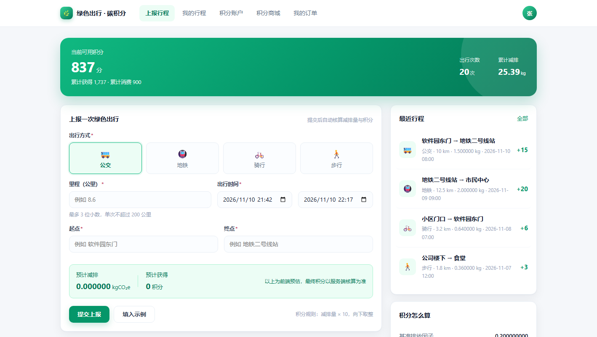
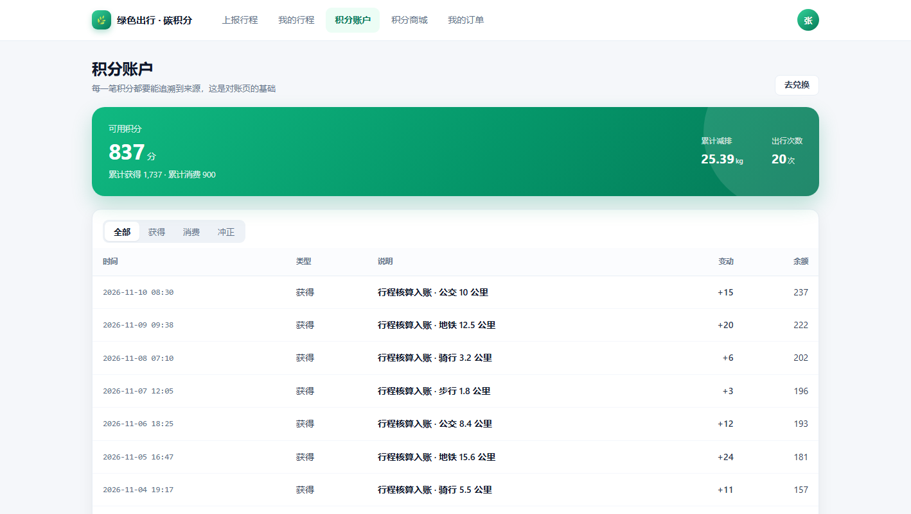
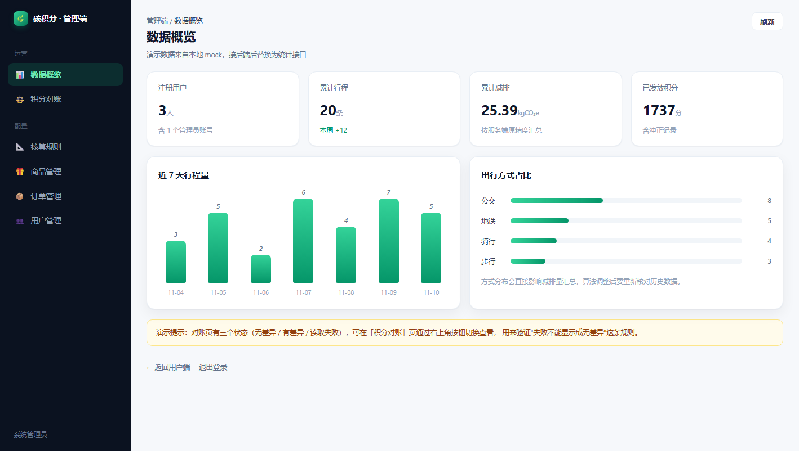
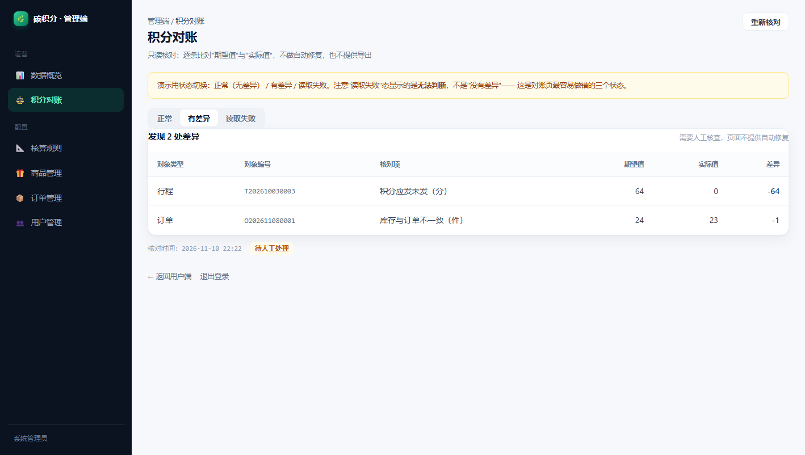

# SE-Carbon-neutlrality

碳中和主题下的城市绿色出行积分系统（软件工程实验项目14）。

模拟上报行程 → 减排核算 → 积分发放 → 商品兑换。

## 实验文档

- [实验一需求分析 v0.2](docs/01-requirements/README.md)
- [业务规则、验收场景与追踪矩阵](docs/01-requirements/business-rules.md)
- [修订依据与AI使用记录](docs/01-requirements/revision-notes.md)
- [在线查看 UML 图片](docs/01-requirements/diagrams/README.md#图片预览)
- [StarUML综合工程](docs/01-requirements/diagrams/lab1-all-models.mdj)

当前已有**可运行的前端演示版**（见下），后端尚未实现。统一需求以main分支上述目录为准；其他分支的Sprint 0和消息队列方案为历史草案，不混用编号或技术选型。

## 前端演示版

代码位于 [frontend/](frontend/README.md)，Vue 3 + TypeScript + Vite，数据来自本地 mock（接口契约与后端一致，切换环境变量即可接真实后端）。

- 用户端：行程上报 → 减排核算 → 积分账户 → 商城兑换 → 我的订单
- 管理端：数据概览、积分对账、核算规则、商品/订单/用户管理
- 桌面运行：`cd frontend` → `npm install` → `npm run build:single` → 双击 `启动桌面版.bat`
- 演示账号：普通用户 `13800138000` / 密码 `123456`；管理员 `admin` / `123456`

| 首页 | 积分账户 |
|---|---|
|  |  |

| 管理端概览 | 积分对账 |
|---|---|
|  |  |
