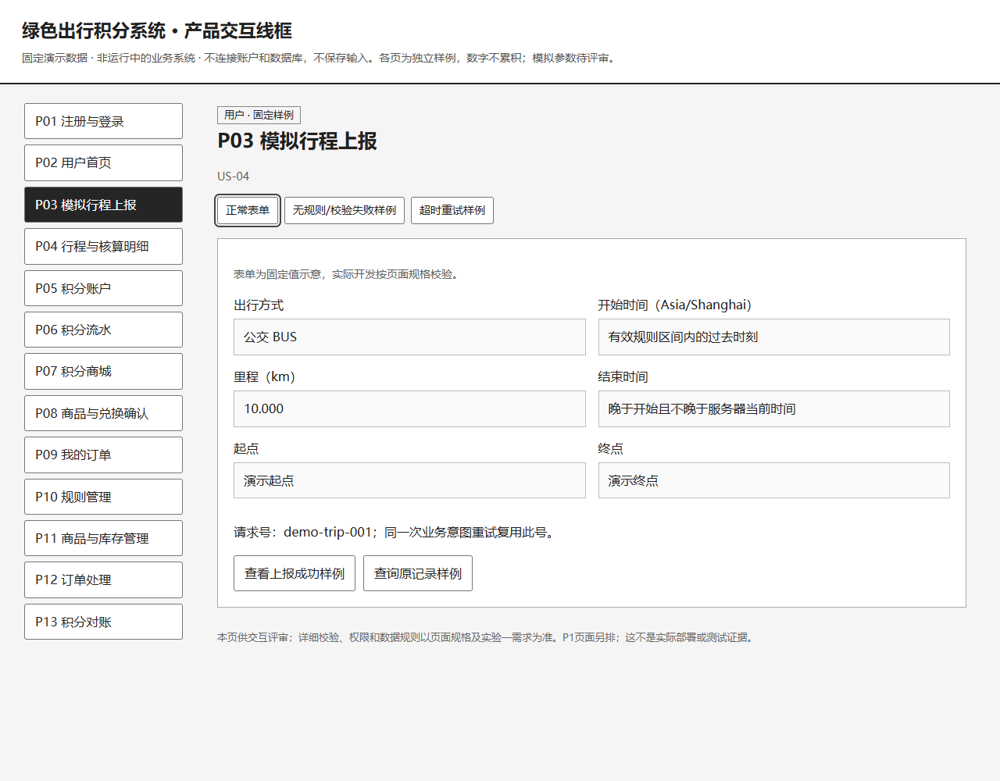
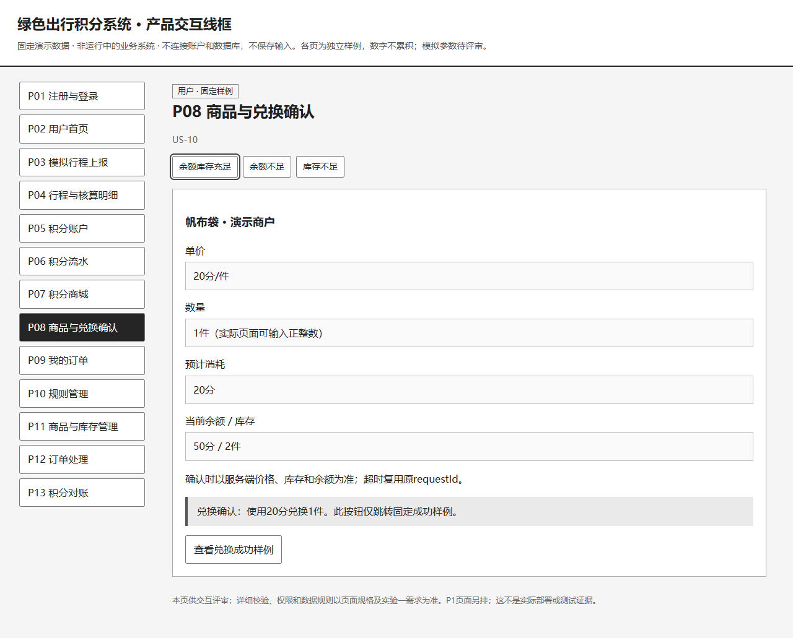

# 产品工作台

项目14：碳中和主题下的城市绿色出行积分系统。负责人：魏嘉鑫。整理日期：2026-11-10。

本工作包把实验一需求转成页面、交接任务和验收步骤，供小组开展实验二设计和开发。用户已确认：课程截止尚未通知，教师没有额外技术限制，允许拟定课程模拟参数供评审。具体模拟数值、相对工期及新增交互尚待小组确认，软件业务测试尚未执行。

## 从这里开始

1. [确认事项和模拟参数](decisions.md)：PM-01先处理，区分已确认与拟议。
2. [页面需求与交互](page-spec.md)：13个P0页面，覆盖全部P0故事；3项P1另排。
3. [点击查看线框原型源文件](prototype.html)：下载到本地双击打开；GitHub普通文件页显示源码。使用固定演示数据，不连接账户或数据库。
4. [任务与相对工期](delivery-plan.md)：12项任务，负责人按最新分工；D不是承诺的日历日期。
5. [验收清单与记录表](acceptance-checklist.md)：复用TC-01～TC-20，结果均待实际执行。
6. [实验二设计评审清单](design-review.md)：明确设计交接及正式UML缺口。
7. [评审记录](review-records.md)：实验一历史确认与新增待评审项分开。
8. [GitHub任务索引](issue-index.md)：查看实际Issue和负责人。
9. [实验二关键设计草案](https://github.com/jiaxinwei39-a11y/SE-Carbon-neutlrality/blob/main/docs/02-design/key-design.md)：从D盘既有草案同步，保留未确认状态。

## 基线和协作

- 本包引用稳定的US编号和功能名称；UC对应关系请查当前故事—用例追踪表，兼容独立进行的用例编号迁移。需求编号与优先级沿用[实验一](https://github.com/jiaxinwei39-a11y/SE-Carbon-neutlrality/tree/main/docs/01-requirements)，US和UC依当前追踪矩阵对应。
- 产品经理决定功能目标和验收口径；UI/UX负责交互和视觉；前后端协商接口；李金平协作测试、后端和部署。架构与数据库由技术负责人评审，小组确认。
- 本包是AI辅助整理的工作成果，不代表任何成员已完成开发或参加了新评审。个人贡献应记录实际修改、设计、代码、测试和评审。
- 优先实现“注册登录→上报行程→查看减排和积分→兑换→运营履约/取消→对账”。P1不挤占P0验证时间。
- 参考[GitHub开源治理指南](https://github.com/github/opensource.guide/blob/main/_articles/zh-hans/leadership-and-governance.md)的角色与可追踪贡献方法；未复制其代码或引入新依赖。

## 原型预览

下图为本次线框原型的真实浏览器截图。下载prototype.html后可离线点击13个页面与示例分支。

## 验证记录

2026-11-10使用无头Edge检查13页导航、当前页标识、行程失败/超时、兑换失败/成功、取消/履约与对账差异/失败分支；390px宽度的三个核心页无整页横向溢出。JavaScript页面错误0，外部网络请求0。另对本包链接、任务依赖、US/UC对应和Decimal样例做静态核对。原型检查不能替代应用业务、数据库、安全和并发测试。
