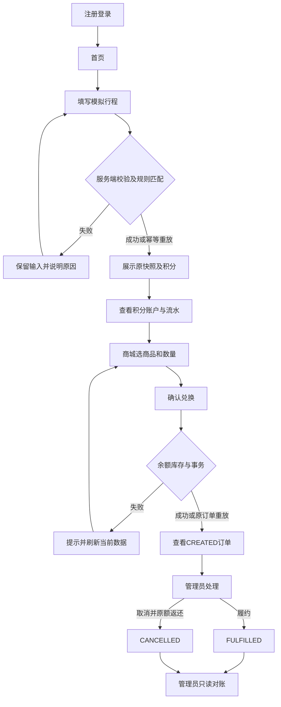

# 页面需求与交互说明

状态：产品补充草案，待小组评审。页面编号P01～P13是页面导航编号；US编号保持不变，当前UC对应关系以仓库故事—用例追踪矩阵为准。这里规定功能内容和状态，视觉风格由张生阳设计。原型为固定样例线框，未实现的交互以本规格为准。

## 页面清单

| 页面 | 角色 | 需求（US） | 主要内容与操作 | 验收关注 |
| --- | --- | --- | --- | --- |
| P01 注册与登录 | 匿名、用户、管理员 | US-01、US-02 | 注册用户名/密码/昵称；登录用户名/密码；明确失败提示；注册固定普通用户角色 | 重复名、错误凭据、角色路由与敏感信息 |
| P02 用户首页 | 用户 | US-05、US-07 | 当前余额、最近行程、上报入口、商城入口；无记录时引导首次上报 | 仅本人数据，不混用汇总与单次结果 |
| P03 模拟行程上报 | 用户 | US-04 | BUS/SUBWAY/BIKE/WALK、里程km、起终点、开始/结束时间；提交和重试 | 大于0且≤200km、≤3位小数、必填和合法时间 |
| P04 行程与核算明细 | 用户 | US-05、US-06 | 本人行程列表、方式/时间筛选；详情显示输入、基准/实际因子、减排、积分、规则版本和计算时间 | 快照可解释，不用新规则重算；展示舍入说明 |
| P05 积分账户 | 用户 | US-07 | 服务端当前余额、查看流水和商城按钮 | 不通过前端计算或本地存储作为账目依据 |
| P06 积分流水 | 用户 | US-08 | 时间、类型、关联业务号、变动值、变动后余额、分页 | 发放/扣减/冲正只读，无编辑删除 |
| P07 商城列表 | 用户 | US-09 | 上架商品名称、商户、积分单价、库存、缺货提示、详情入口 | 下架不展示；空商城有空态 |
| P08 商品与兑换确认 | 用户 | US-10 | 名称/商户/说明、单价、库存、正整数数量、预计总积分、确认按钮 | 服务器最终定价；余额库存不足或下架正确拒绝 |
| P09 我的订单 | 用户 | US-11 | 订单列表/详情、原单价和成本快照、数量、状态、创建/处理时间与取消原因 | 仅本人；普通用户无取消/履约入口 |
| P10 规则管理 | 管理员 | US-16 | 方式、版本、基准因子、方式因子、积分系数、生效区间、原因；发布新版本 | 非负≤6位小数、区间不重叠、不可覆盖旧因子、禁止追溯 |
| P11 商品与库存管理 | 管理员代商户 | US-12 | 商户归属、名称、说明、正整数积分价格、非负整数库存、上下架；变更原因 | 服务端约束与审计；有关联历史商品仅下架 |
| P12 订单处理 | 管理员代商户 | US-13 | 列表/详情；CREATED可履约或填写原因取消；处理后刷新状态 | FULFILLED/CANCELLED终态不可逆；重复操作安全 |
| P13 积分对账 | 管理员 | US-17 | 发起只读核对、核对时间、对象编号、期望/实际与差异；失败状态 | 一致性快照，不出现自动修复按钮 |

P1追加页面：个人资料（US-03）、运营统计（US-14）、用户启停（US-15）。P0通过后另排工期，尚未实现时不得展示成功或宣称完成。

## 表单与响应状态

所有需要加载的数据页面提供加载、空、成功和失败四态；无权限单独提示。请求失败保留用户输入，敏感密码不落日志；没有确认成功前不能本地加减积分或创建成功订单。

- P03初次提交前生成clientTripId，同一业务意图的超时重试复用；服务端按身份、启用状态和归属验证后处理。相同键不同业务输入提示冲突；修改业务输入作为新意图需明确由用户再次提交，不能自动换键重试。
- P03时间以Asia/Shanghai展示，传输带时区；startTime < endTime ≤服务器当前时间。浏览器时间仅预校验，服务器结论为准。
- P04页面可展示6位小数并标“展示值已舍入”，明细原精度为9位；积分由后端原精度核算。零积分仍显示成功行程并说明无积分流水。
- P08请求前生成requestId；同键同商品同数量重放原订单，不能因现价/下架重复收费。二次确认是误操作防护，服务端必须处理并发变化。
- P10有效期为左闭右开，空结束代表无穷远；按行程结束时间选规则。表单不允许直接改写已发布因子。
- P12取消原因必填；确认文案写明返还原订单积分和数量；取消和履约并发冲突后刷新真实终态。
- P13读取失败显示“核对失败”，不能显示为“无差异”；差异是报告，不触发修复。
- 超时文案：“结果尚未确认，请保留本次请求后重试或查询记录”；400校验、401登录失效、403无权限、404不存在、409冲突与服务错误分别提示。具体错误码由DES-01锁定。

## 核心交互路径

## 交接清单

魏嘉鑫确认功能、边界和文案；张生阳补充视觉、布局和状态标注；高泽核对每个字段/按钮对应的API；郭浚文确认返回值、权限与事务；李金平把异常路径拆成测试。13页线框只作为交互起点，不能替代StarUML正式模型或实际前后端开发。
