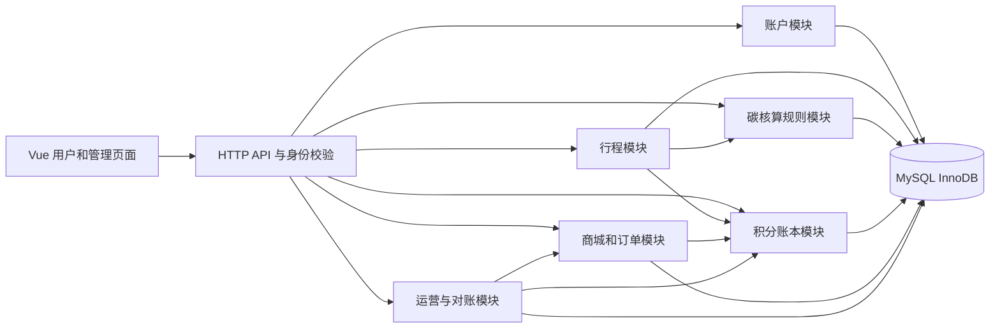
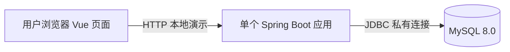
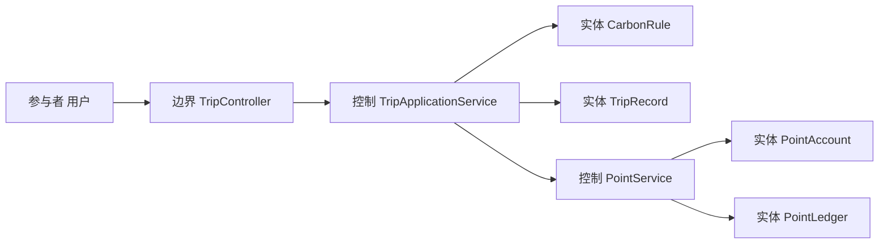
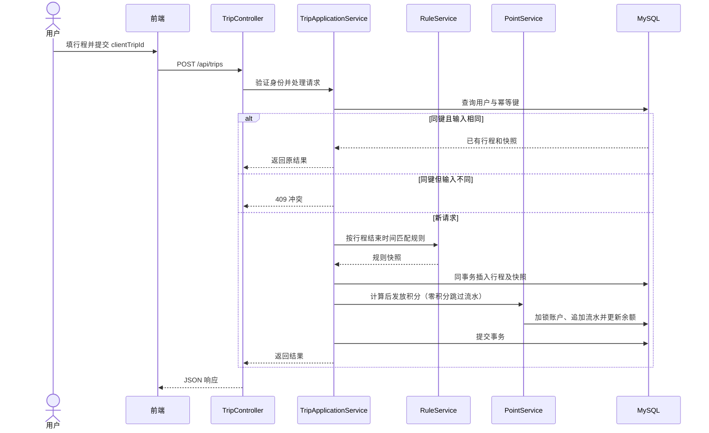
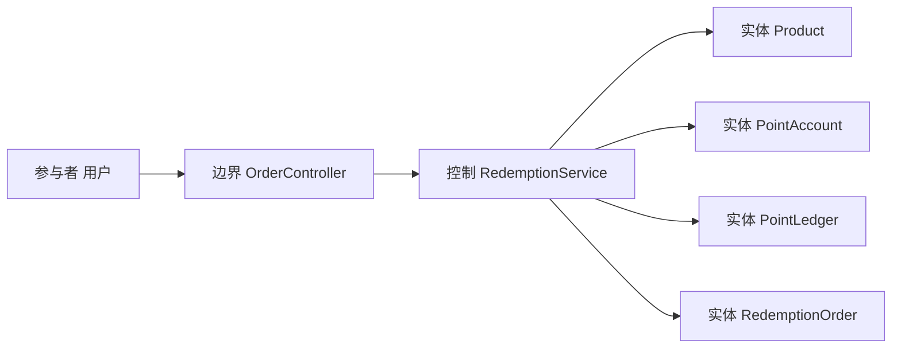
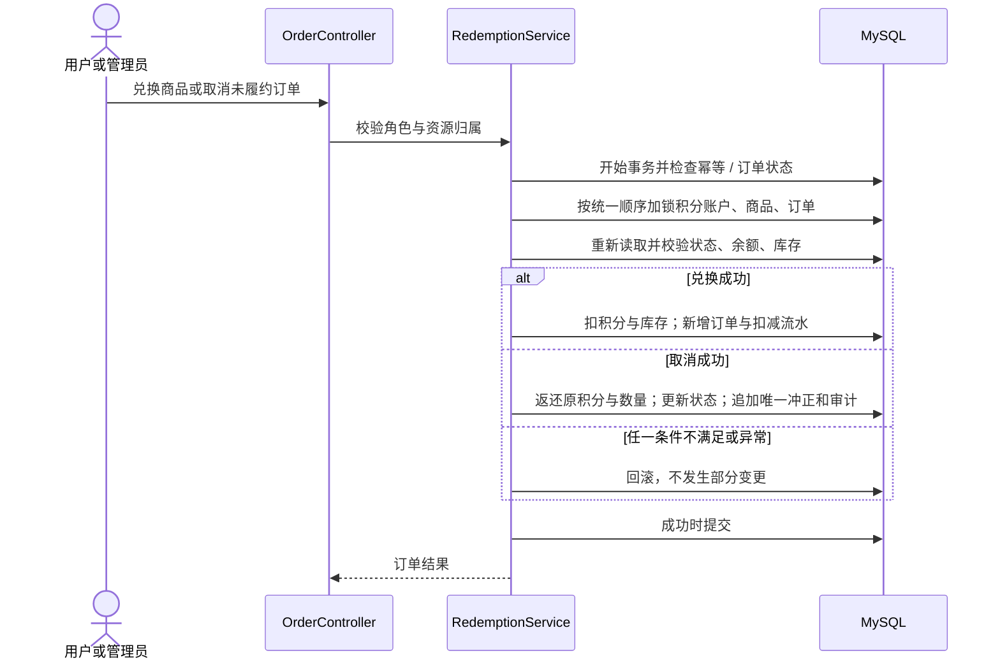
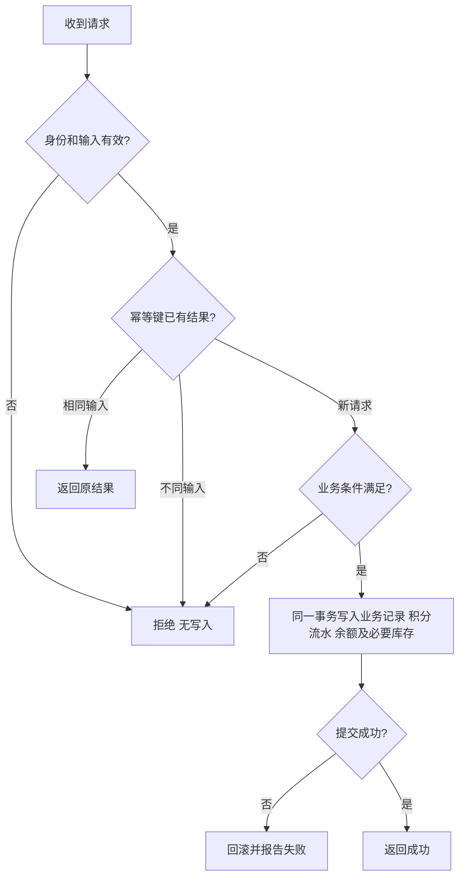

# 实验二关键设计方案

项目：碳中和主题的城市绿色出行积分系统（项目14）
依据：实验指导书的设计规格说明书和仓库实验一业务基线 `2860754`；最新分工与产品补充见产品工作台
状态：设计草案，待小组及指导教师确认；不是已实现或已测试的系统。
范围：架构比较、模块与部署、核心用例交互、数据模型、接口和事务设计。本文中的 Mermaid 图用于直观讨论，逻辑结构图与部署示意图并非标准 UML 包图或部署图；鲁棒图以边界/控制/实体关系表达，正式报告所需的 UML 模型应据此在 StarUML 中完成并核对。

## 1 总体设计与技术选型

### 1.1 需求与约束

系统完成模拟出行上报、碳减排核算、积分发放、商品兑换和运营管理；行程、积分、库存与订单必须一致。人工上报不证明真实出行，积分不可提现。商户为业务相关方，MVP 无独立商户登录，由运营管理员代办。课程团队 5 人，技术难度及开发周期应可控。指导书建议对行程触发发分和清算考虑事件驱动。

### 1.2 架构比较

| 方案 | 优点 | 代价与局限 | 本项目判断 |
| --- | --- | --- | --- |
| A 单体分层，模块内直接同步调用 | 开发、部署和本地事务简单，容易调试 | 需要通过接口约束模块依赖；业务联动调用方了解下游 | 低成本可行，作为备选 |
| B 模块化单体、同步进程内事件、本地事务 | 单体部署、模块边界清晰；事件可描述业务变化；关键账务同事务 | 监听逻辑仍运行在进程内；不能凭“发布事件”保证异步可靠或独立扩展；异常与顺序须明确 | **推荐方案**，满足课程范围与一致性要求 |
| C 多服务加消息队列的异步事件驱动 | 可独立扩展和部署；事件消费较松耦合 | 增加网关、消息投递、幂等、重试、可观测性和跨服务一致性成本 | 课程原型暂不采用，可作为未来扩展方向 |

B 是一个建议，不是教师批准结论。应用仍为单一部署单元，不把事件称为跨进程可靠消息。核心业务事件同步执行、异常上抛、随调用方事务提交或回滚；只在数据库提交成功后返回成功。不将 `@TransactionalEventListener` 默认的提交后阶段误写成事务内；实现时可用同步领域服务调用或明确同步监听器，但必须验证调用链、事务代理、异常传播。若引入异步，须重新设计投递、重试、重复消费与一致性，不能沿用本方案的原子性结论。

### 1.3 建议技术栈

| 层次 | 建议 | 状态 |
| --- | --- | --- |
| 前端 | Vue 3 + Vite + JavaScript；VS Code | 方案建议，版本由团队锁定 |
| 后端 | Java + Spring Boot + Maven；IDEA | 方案建议，具体依赖版本在项目初始化时统一锁定 |
| 数据库 | 已安装的 MySQL 8.0，InnoDB，utf8mb4 | 现有 MySQL 曾成功登录；项目库及连接尚未建立 |
| Java 运行时 | 优先选可用的长期支持版 JDK，并按 Spring Boot 选定版本的官方兼容清单确认 | 当前 IDEA 截图为 JDK 25，不假定已经安装或切换其他版本 |
| 架构与建模 | UML、StarUML；接口采用 HTTP/JSON | 图和接口为设计，尚未部署 |

### 1.4 系统逻辑结构示意

模块仅通过服务接口交互，控制层不直接操纵其他模块的表。TripReported、EmissionCalculated、PointsGranted、RedemptionRequested、RedemptionOrderCreated、RedemptionCancelled 仅为候选同步领域事件；具体事件粒度在编码时确定。事件日志不替代账本，不能把监听器失败吞掉后继续提交。

### 1.5 系统部署示意

课程演示可在一台电脑启动前端开发服务器、后端和本机数据库；正式部署时前端可由静态服务提供。端口、账号及环境变量以实际配置为准，不在仓库存储密码。跨网络部署时使用 HTTPS 和最小权限数据库账号；该图不表示已部署。

## 2 核心模块与设计类

| 模块 | 主要责任 | 边界类示例 | 控制类示例 | 实体 |
| --- | --- | --- | --- | --- |
| 账户 | 注册、认证、角色和用户状态 | AuthController、UserController | AuthService、UserService | User、PointAccount |
| 行程 | 数据校验、幂等、记录和结果 | TripController | TripApplicationService | TripRecord |
| 碳核算 | 规则配置、按结束时间匹配、计算快照 | CarbonRuleController | RuleService、CarbonCalculator | CarbonRule |
| 积分 | 余额、只追加流水、对账 | PointsController | PointService、ReconciliationService | PointAccount、PointLedger |
| 商城 | 商品、库存、兑换、履约与取消 | ProductController、OrderController | ProductService、RedemptionService | Merchant、Product、RedemptionOrder |
| 运营 | 汇总和审计查询 | AdminController | StatisticsService、AuditService | AuditLog、业务实体 |

边界/控制/实体为逻辑角色，并非承诺最终类名、代码或数据库实现。审计是支持数据，不更改实验一的八个核心领域实体。设计类、图和代码实现后须再次同步。

### 2.1 鲁棒分析：行程上报

边界负责解析请求和认证；控制负责幂等、校验、核算和事务；实体提供业务状态。此图是鲁棒关系示意，提交报告前按边界、控制、实体规范绘制 StarUML 鲁棒图。

### 2.2 序列：模拟行程与积分发放

并发同键首次提交时，唯一约束是最终防线。发生唯一冲突的事务整体回滚；在新的只读事务重新读取已提交行程，核对请求规范化内容再返回或冲突；若对方尚未提交或回滚，按受控重试处理，不能读取未提交的部分结果。失败不保留半成品行程。

### 2.3 鲁棒分析：商品兑换

### 2.4 序列：积分兑换与取消

锁顺序为账户 → 商品 → 已有订单；取消时先无锁读取订单以获得账户和商品标识，再依次加锁并重新读取订单及状态，标识和状态不符则拒绝或回滚。新增订单不存在时无需锁该订单；对同幂等键由唯一索引裁决。所有涉及同一批资源的写操作遵守同顺序；死锁或锁等待超时整体回滚后可有限重试，同幂等键不能更换。订单状态只能 CREATED→FULFILLED 或 CREATED→CANCELLED，终态不可交叉更改。

### 2.5 活动流程：发分与兑换

活动图为核心共同分支的设计摘要，不替代实验一的 3 张具体活动图；程序级活动图与实际代码的关键操作还需在实现时细化。

## 3 数据库关键设计

### 3.1 约定与边界

建议数据库名 `carbon_travel`，InnoDB / utf8mb4。下列是设计规格，不会自动创建数据库。主键建议 `BIGINT UNSIGNED` 自增，API 对外序列化为十进制字符串，避免 JavaScript 精度问题；角色及状态用受控字符串，时间统一以 UTC 保存并在 Asia/Shanghai 展示。金额不用浮点。除标注可空外均非空；`created_at` / `updated_at` 是 UTC 时间，格式 `DATETIME(6)`；字符串长度和日期范围是初始设计，建库前需小组评审。表名中的 `user` 采用 `app_user` 避免通用名称冲突。外键列、删除策略都必须在迁移文件中声明；核心历史记录禁止级联删除。

### 3.2 表清单与字段

类型后 `?` 表示可空，PK 主键、FK 外键、UQ 唯一；索引均为建议的 InnoDB B-tree，InnoDB 主键为聚簇索引，其他普通/唯一索引为二级索引。未注明默认值的业务字段由应用显式填写。各枚举值需应用校验，生产 SQL 对 MySQL 8.0.46 可用的约束进行实测。

| 表（中文） | 字段：类型及约束 | 索引、关联、说明 |
| --- | --- | --- |
| app_user 用户 | id BIGINT UNSIGNED PK；username VARCHAR(64)；password_hash VARCHAR(255)；nickname VARCHAR(64)；role VARCHAR(16)；status VARCHAR(16)；created_at DATETIME(6) | UQ(username)；role USER/ADMIN；status ACTIVE/DISABLED；密码为单向带盐哈希 |
| merchant 商户 | id BIGINT UNSIGNED PK；name VARCHAR(100)；status VARCHAR(16)；created_at DATETIME(6) | 状态 ACTIVE/DISABLED；商户无独立登录 |
| carbon_rule 碳规则 | id BIGINT UNSIGNED PK；travel_mode VARCHAR(16)；baseline_factor DECIMAL(12,6)；mode_factor DECIMAL(12,6)；points_per_kg DECIMAL(12,6)；effective_from DATETIME(6)；effective_to DATETIME(6)?；version VARCHAR(64)；status VARCHAR(16)；created_by BIGINT UNSIGNED FK；created_at DATETIME(6)；change_reason VARCHAR(255) | UQ(version)；IDX(travel_mode,effective_from)；created_by→app_user.id；同方式区间不重叠由事务串行化控制 |
| trip_record 行程 | id BIGINT UNSIGNED PK；user_id BIGINT UNSIGNED FK；client_trip_id VARCHAR(64)；origin VARCHAR(128)；destination VARCHAR(128)；mode VARCHAR(16)；distance_km DECIMAL(8,3)；start_time DATETIME(6)；end_time DATETIME(6)；baseline_emission_kg DECIMAL(24,9)；actual_emission_kg DECIMAL(24,9)；reduction_kg DECIMAL(24,9)；awarded_points BIGINT UNSIGNED；rule_id BIGINT UNSIGNED FK；rule_version VARCHAR(64)；baseline_factor DECIMAL(12,6)；mode_factor DECIMAL(12,6)；points_per_kg DECIMAL(12,6)；calculated_at DATETIME(6)；status VARCHAR(16) | UQ(user_id,client_trip_id)；IDX(user_id,end_time)；user_id→app_user；rule_id→carbon_rule；POINTED；保存规则快照 |
| point_account 积分账户 | id BIGINT UNSIGNED PK；user_id BIGINT UNSIGNED FK；balance BIGINT UNSIGNED DEFAULT 0；version BIGINT UNSIGNED DEFAULT 0；last_seq BIGINT UNSIGNED DEFAULT 0 | UQ(user_id)；user_id→app_user；注册时同事务创建，账户行锁控制余额与序号 |
| point_ledger 积分流水 | id BIGINT UNSIGNED PK；account_id BIGINT UNSIGNED FK；account_seq BIGINT UNSIGNED；business_type VARCHAR(32)；business_id BIGINT UNSIGNED；change_points BIGINT；balance_after BIGINT UNSIGNED；created_at DATETIME(6) | UQ(account_id,account_seq)；UQ(business_type,business_id)；IDX(account_id,created_at)；account_id→point_account；业务编号多态关联在服务层校验；追加不可修改 |
| product 商品 | id BIGINT UNSIGNED PK；merchant_id BIGINT UNSIGNED FK；name VARCHAR(128)；description VARCHAR(1000)；points_price BIGINT UNSIGNED；stock BIGINT UNSIGNED；status VARCHAR(16)；version BIGINT UNSIGNED DEFAULT 0；created_at DATETIME(6) | merchant_id→merchant；IDX(status,id)；price > 0、stock ≥ 0；关联订单或流水后仅下架 |
| redemption_order 兑换订单 | id BIGINT UNSIGNED PK；user_id BIGINT UNSIGNED FK；product_id BIGINT UNSIGNED FK；request_id VARCHAR(64)；quantity INT UNSIGNED；points_price_snapshot BIGINT UNSIGNED；points_cost BIGINT UNSIGNED；status VARCHAR(16)；created_at DATETIME(6)；processed_by BIGINT UNSIGNED? FK；processed_at DATETIME(6)?；process_reason VARCHAR(255)? | UQ(user_id,request_id)；IDX(user_id,created_at)；product_id→product；processed_by→app_user；CREATED/FULFILLED/CANCELLED |
| audit_log 操作审计 | id BIGINT UNSIGNED PK；operator_id BIGINT UNSIGNED FK；action VARCHAR(32)；target_type VARCHAR(32)；target_id BIGINT UNSIGNED；before_json JSON?；after_json JSON?；reason VARCHAR(255)?；created_at DATETIME(6) | IDX(target_type,target_id,created_at)；operator_id→app_user；规则、商品库存及订单管理与审计同事务 |
| rule_mode_lock 规则串行化 | travel_mode VARCHAR(16) PK | 四种方式各一行，修改规则先按 travel_mode 获取行锁，再校验整个时间区间，保证并发写入不重叠 |

关联说明：`redemption_order.user_id`→`app_user.id`；各 FK 均采用 RESTRICT/NO ACTION，历史数据不得物理级联删除。`rule_mode_lock` 是控制并发的技术表，不是新增领域实体。版本字段不自动替代锁或校验。

### 3.3 精度、上限与索引完整性

距离 >0 且 ≤200.000 km，最多三位小数；因子和积分系数非负、最多六位小数，受 DECIMAL(12,6) 上限约束；计算中使用 BigDecimal，不用浮点。最大排放结果在 DECIMAL(24,9) 范围内；乘积分系数之后必须先以高精度检查计算结果 ≤ BIGINT 有符号上限 9223372036854775807，再写入正负流水，余额加减和价格乘数量均先做溢出检查。时间 `start < end ≤ server now`，规则时间按 `[from,to)`。历史补录按结束时间选择已有版本；改规则不回溯，不覆盖已发布因子。行程计算：基准=里程×基准因子，实际=里程×方式因子，减排=max(0,基准-实际)，积分=floor(减排×系数)。

业务流水 `business_type` 取 TRIP_GRANT、REDEMPTION_DEBIT、REDEMPTION_REVERSAL；每个账户以锁内自增 `last_seq` 分配 `account_seq`，唯一约束加锁保证顺序，不能依赖时间戳。禁止通过应用正常接口改删流水；数据库账号应遵守最小权限，管理员直接改库不在系统保证范围内。零积分成功行程不生成流水。按同一一致性快照（建议只读 REPEATABLE READ 事务内普通一致性读）读取账户、流水和业务单据，对账只读、不自动修账；不能混用不同时间快照并声称一致。

管理规则变更必须锁定 `rule_mode_lock` 对应行，重新校验同方式区间并原子结束旧区间/插入新版本；行程事务按结束时间读取已提交规则并保存快照。业务和 DB 均校验非负、取值范围、身份权限；涉及数据库约束无法表达的区间、状态转换等使用事务和应用校验。事务锁、隔离级别和并发逻辑在真实数据库上做集成测试后才可认定有效。

## 4 API 草案

统一 `/api` 前缀、JSON、UTF-8；成功响应 `{"code":"OK","message":"成功","data":...}`，错误 `{"code":"...","message":"...","data":null}`。金额、主键按字符串返回，时间使用带时区的 ISO 8601；列表使用 `page`（从1开始）、`size`（建议1–100），返回 `items,total,page,size`。非匿名请求先验身份及状态再按角色与资源归属授权；未认证 401，无权限 403，校验错误 400，不存在 404，状态/幂等冲突 409。会话方案（Cookie/Token）、CSRF、跨域及过期策略待技术评审，不在此假定已实现。

| 用例 | 方法 / 路径 | 请求要点 | 返回与权限 |
| --- | --- | --- | --- |
| 注册 | POST /api/auth/register | username,password,nickname | 用户信息；匿名 |
| 登录 | POST /api/auth/login | username,password | 登录态及当前用户；匿名 |
| 个人资料 | GET/PATCH /api/users/me | nickname 等可修改字段 | 当前用户；本人 |
| 上报行程 | POST /api/trips | clientTripId,mode,distanceKm,origin,destination,startTime,endTime | 行程 id、规则、减排与积分、余额；用户 |
| 查询行程 | GET /api/trips；GET /api/trips/{id} | page,size,mode,start,end | 本人数据与快照；用户 |
| 余额与流水 | GET /api/points/account；GET /api/points/ledger | page,size | 本人余额或流水；用户 |
| 商品 | GET /api/products；GET /api/products/{id} | page,size | 上架商品、积分价格及库存；已授权 |
| 兑换 | POST /api/orders | requestId,productId,quantity | 订单、价格快照、余额；用户 |
| 订单 | GET /api/orders；GET /api/orders/{id} | page,size | 用户仅本人，管理员按授权查询 |
| 商品维护 | POST /api/admin/products；PATCH /api/admin/products/{id} | 名称、商户、价格、库存、状态及原因 | 管理员；记录审计 |
| 订单履约/取消 | POST /api/admin/orders/{id}/fulfill；POST /api/admin/orders/{id}/cancel | cancel 必填 reason | 结果状态及冲正结果；管理员 |
| 规则配置 | POST /api/admin/carbon-rules；GET /api/admin/carbon-rules | 方式、因子、生效时间及原因 | 新版本或列表；管理员 |
| 积分对账 | POST /api/admin/points/reconciliations | 可选筛选范围 | 只读核对时间及差异；管理员 |
| 运营统计 | GET /api/admin/statistics | start,end | 指定区间统计；管理员，P1 |
| 停启账户 | POST /api/admin/users/{id}/status | status,reason | 结果及审计；管理员，P1 |

行程和兑换的幂等重放在身份和归属检查之后；同一键不同业务参数返回 409。成功/失败不应暴露密码、token或他人资料。以上接口字段为初稿，尚需前后端共同确认并编写 OpenAPI 规范。

## 5 需求追踪和待办

| 实验一需求 | 关键设计 | 计划验证（未执行） |
| --- | --- | --- |
| US-04、US-16 | 行程/规则、唯一幂等键、规则版本和快照 | 边界时刻、补录、并发重复与回滚 |
| US-07、US-08、US-17 | 账户、流水、账户内序号及同快照对账 | 余额非负、流水一致、并发期间对账 |
| US-10、US-13 | 库存、订单、积分和审计同事务 | 不超卖、不透支、取消只冲正一次、失败回滚 |
| 用户权限 | 用户角色、接口授权及数据归属 | 普通用户越权、停用用户和匿名接口 |

待确认：① 确切依赖版本及 JDK/Spring Boot兼容性（教师无额外技术限制，Vue3/Spring Boot/MySQL为建议方案）；② 产品工作台拟议模拟因子、积分系数的评审结论；③ API 的会话方式及字段；④ 商户运营管理的范围和教师对 EDA 的意见；⑤ 在 StarUML 画正式包图、部署图、鲁棒图、序列图及关键操作活动图；⑥ 完善所有用例的设计类与完整数据库数据字典；⑦ 小组评审后创建迁移脚本、编码与测试。指导书要求的完整实验二成果不应仅靠本文件或 Mermaid 示意图宣称完成。

## 6 依据与参考

- 实验指导书：实验二须比较架构，按报告样本提供包图、部署图、鲁棒图、序列图、设计类清单、关键程序活动图及表详细清单。
- [Spring Petclinic](https://github.com/spring-projects/spring-petclinic)：Spring 单体示例，可参考分层和测试组织；不直接移植业务或声称其满足本项目一致性需求。
- [yshopmall](https://github.com/guchengwuyue/yshopmall)：可参考商城商品与积分场景；功能和部署复杂度超出本项目，不整体复制。
- [MySQL 8.0 锁机制](https://dev.mysql.com/doc/refman/8.0/en/internal-locking.html)、[一致性读](https://dev.mysql.com/doc/refman/8.0/en/innodb-consistent-read.html)：事务、加锁与快照的设计依据。
- [Spring Framework 事务回滚规则](https://docs.spring.io/spring-framework/reference/data-access/transaction/declarative/rolling-back.html)：默认回滚规则须结合异常类型与实际代理行为验证。

## 7 产品与设计交接补充

2026-11-10用户确认截止尚未通知、教师无额外技术限制，允许拟课程演示模拟参数但须标待评审。最新分工：产品经理魏嘉鑫，UI/UX张生阳，前端高泽，后端郭浚文，全栈/测试兼运维李金平；组长高泽保留。

[产品工作台](../00-product/README.md)提供页面、模拟参数、任务、验收和评审清单。正式UML、完整数据字典、迁移与业务实现仍待相应任务完成；本次同步草案不等于完成实验二。
