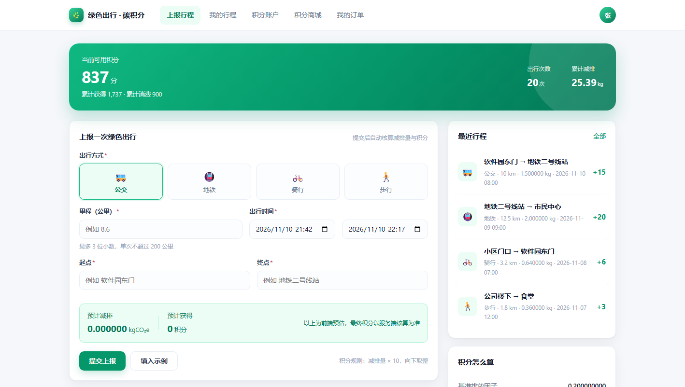
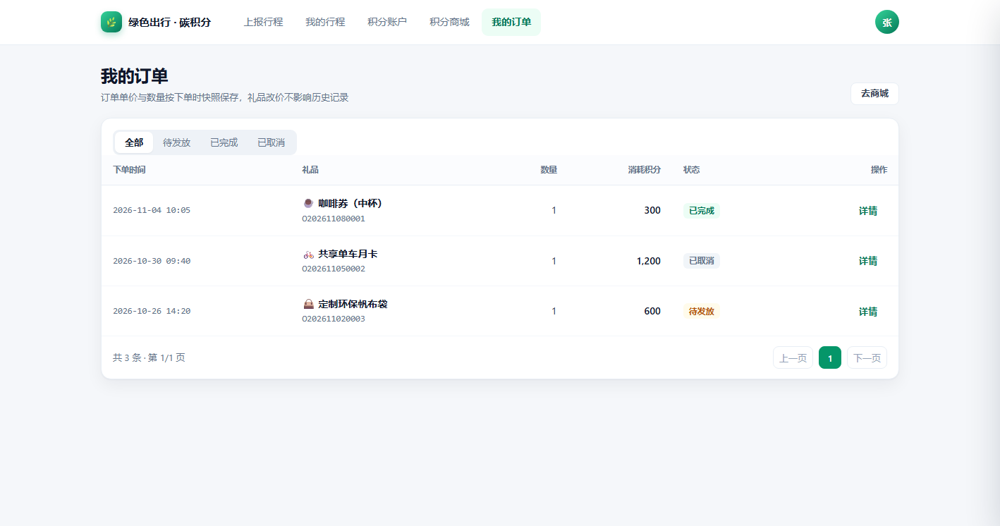
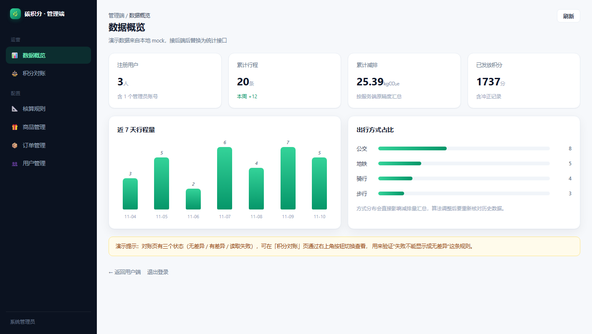

# 绿色出行 · 碳积分（前端演示版）

软件工程实验 · 前端交付物。**桌面独立窗口运行，不连接后端与数据库**，数据来自本地 mock，
但接口形状、字段命名、错误码、幂等键都按《接口契约》实现，接后端时只换数据源、不改页面。

- 技术栈：Vue 3.5 + Vite 6 + TypeScript(strict) + Vue Router 4(hash) + Pinia 3 + Axios（Electron 壳可选）
- 页面：用户端 9 页 + 认证 2 页 + 状态页 2 页 + 管理端 6 页
- 样式：自建设计 token 与组件类（`src/styles/`），未引入 Element Plus 等 UI 库



| 我的积分 | 积分商城 |
| --- | --- |
|  |  |

| 用户端 · 我的订单（只读，无取消入口） | 管理端 · 订单履约（取消 / 发放） |
| --- | --- |
|  |  |

| 管理端 · 数据概览 | 管理端 · 积分对账 |
| --- | --- |
|  |  |

## 一、怎么启动

### 方式 1：桌面窗口（推荐，就是最终交付形态）

双击 **`启动桌面版.bat`**：它会把 `src` 打包成**单个 index.html**（`dist-app/`），
再用 Chrome/Edge 的「应用模式」开一个 1440×900 的独立窗口——没有地址栏、没有标签页，看起来就是一个桌面软件。

> 为什么要打成单文件：`file://` 下多文件构建的 `<script type="module">` 会被浏览器按跨域拦截（白屏），
> 单文件内联后就没有这个问题。Electron 同理，也是因为这个原因才用单文件产物。
> （本机 electron.exe 受运行环境限制启动即崩，属环境问题，不影响用窗口模式演示。）

### 方式 2：浏览器里看（调试最快）

双击 **`启动演示.bat`**，或执行：

```bat
npm run dev
```

然后访问 http://localhost:5173 。

> 如果 npm 报权限错误，先执行一次：
> `npm config set cache "%CD%\.npm-cache"`

## 二、演示账号

| 角色 | 账号 | 密码 | 进去能看到 |
| --- | --- | --- | --- |
| 普通用户 | `13800138000` | `123456` | 首页上报、行程、积分、商城、订单 |
| 管理员 | `admin` | `123456` | 管理端（概览/规则/商品/订单/对账/用户） |

## 三、演示脚本（答辩用，一条链路走完 5 分钟）

1. 用普通用户登录 → 首页看到积分余额与"近 30 天减排"。
2. 在首页表单填：地铁、10 km、起终点、起止时间 → 提交。
3. 自动跳到 **行程核算明细**：讲"因子快照 + 9 位原精度 + 积分取整"这三件事。
4. 进 **我的积分**：刚发的积分出现在流水顶部，余额变化。
5. 进 **积分商城** → 选一个商品 → 数量步进器 → 兑换 → **我的订单** 里出现新订单。
   > 用户端订单是只读的：没有取消按钮（取消权限在运营侧，见第 8 条）。
6. 换 `admin` 登录 → **积分对账** 页，切换三个状态：无差异 / 有差异 / 读取失败。
   > 重点讲："读取失败显示的是**无法判断**，不是没有差异"。
7. 管理端 **订单管理** → 打开待发放订单 → **确认发放**（二次确认）→ 状态变「已完成」。
   > 重点讲："发放只改状态，积分和库存在兑换时已经扣过，绝不二次扣减"。
8. 同页 **取消订单**（原因必填）→ 积分原额返还、库存回补、流水出现"冲正"；
   再点一次取消 → 返回原结果、**不会二次返还**（幂等）。
9. 管理端 **商品管理** → 改库存或点「下架」→ 回用户端商城，该商品立刻消失/价格更新。
   > 重点讲："改价不追溯——订单里存的是下单那一刻的单价快照"。

## 四、目录结构与职责

```
src/
├─ api/            接口层（页面只从这里拿数据）
│  ├─ http.ts      axios 实例 + 响应体校验 + 401 处理 + 幂等键
│  ├─ mock.ts      本地假后端（接后端后删掉/关掉即可）
│  └─ auth|trips|points|mall|orders|admin.ts   按模块分文件
├─ router/         路由 + 守卫（登录态、ADMIN 角色）
├─ stores/         Pinia：用户与登录态
├─ layouts/        UserLayout / AdminLayout
├─ components/     自建的 13 个基础组件
├─ views/          页面（user / admin / auth / state）
├─ styles/         tokens.css 设计变量、base.css 基础、components.css 组件类
├─ types/          全部数据结构（TS interface）
└─ utils/          格式化（6 位/9 位小数）与常量（状态文案、颜色）
```

## 五、接后端时要改的地方（只有这些）

**三步切换（已备好，不用改任何页面代码）：**

```bash
# 1. 复制环境变量模板
cp .env.example .env.local

# 2. 改 .env.local 两行
#    VITE_DATA_SOURCE=api
#    VITE_API_BASE_URL=/api            （走 dev server 代理，后端不用管 CORS）
#    VITE_PROXY_TARGET=http://localhost:8080   （后端在哪台机器就写哪台）

# 3. 先验后端通不通，再开前端
npm run smoke:api                      # 或 npm run smoke:api http://192.168.1.23:8080/api
npm run dev
```

`npm run smoke:api` 会按契约顺序打一遍：**注册 → 登录 → /auth/me → 上报行程（含幂等：同键同输入回放、同键换内容 40904）→ 积分账户/流水 → 行程详情（因子快照、精度与积分公式）→ 列表分页 → 越权**，输出 ✓/✗ 和实测值，退出码非 0 就是没通。对着失败项查比一句句点页面快得多。

> ⚠️ **它会写数据**：注册 1~2 个账号、上报 2 条行程（10 km 与 7.77 km 公交）并产生对应积分流水。
> 请只对**测试库 / 测试后端**运行，不要对着演示库或生产库跑；演示库事后可用 `db/reset-demo.sql` 复位。
>
> 关于"精度"验收到哪一步，说清楚免得误读：JSON 数字存不住尾零（后端给 `1.500000000`，`JSON.parse` 后就是 `1.5`），
> 所以**没法用字符串长度证明"保留 9 位"**。脚本改成验"**没有被提前舍入**"：10 km 公交必须是 `1.5 kg / 15 分`，
> 7.77 km 公交必须是 `1.1655 kg / 11 分`（若后端舍到 2 位会变成 `1.17`，脚本立刻报红）。
> 幂等也不只看行程号相同：还会比对**余额只增一次**、**流水条数不变**、以及流水 `refId` 确实指向该 `tripId`。

**其它注意事项：**

1. `src/api/http.ts`：确认响应体是 `{ code, message, data }`、`code === 0` 表示成功（这一层已经把"拆壳"和 401/403/409 都归一了）。
2. 生产部署时不用 dev 代理，改成 Nginx 反代：`location /api/ { proxy_pass http://后端:8080/api/; }`，并且后端要放行 `Authorization` 与 `Idempotency-Key` 头。
3. 代码里所有 `// [接后端]` 注释处 = 需要跟后端确认的地方。
4. 后端字段若与 `src/types/index.ts` 不一致，**改类型文件，不改页面**。

## 六、这份 demo 有意做的"较真"之处（答辩加分点）

| 点 | 在哪看 | 为什么重要 |
| --- | --- | --- |
| 三态（加载/空/错） | 任意列表页 | 加载中显示"暂无数据"是典型错误 |
| 两种空态 | 行程/商城 | 首次无数据 vs 筛选无结果，给的按钮不一样 |
| 失败不冒充成功 | 对账页、提交超时 | 读取失败 ≠ 没有差异 |
| 幂等键 | 上报、兑换 | 重复点击/网络重试不会重复加分 |
| 精度 | 核算明细 | 页面 6 位、明细 9 位、积分取整用原值 |
| 快照 | 订单详情、行程明细 | 规则/价格改了，历史记录不能跟着变 |
| 权限 | 守卫 + 403 页 | 前端只做体验，真权限在后端 |

## 七、已知限制（写进实验报告"不足与改进"）

> 口径说明：**A、B 两段要分开读**。
> A 段**是 P0 里没做完的部分**，不是"降级成 P1 已结案"；若要缩减范围，必须先出产品范围变更确认（组长在组会拍板），再统一改文档，详见 `docs/scope-decisions.md`。
> B 段是**本来就不在本阶段、属于 P1 后续**的功能，不构成当前交付的验收阻塞。

**A. P0 未完成（不构成"已结案"，需范围变更才能缩减）**

- **商品维护**：只做了改价 / 改库存 / 上下架；新增商品、删除、图文维护未做。
- **规则编辑**：页面只读并标注「只读 · 规则维护排期 v1.1」，未做版本化编辑。

> 注册已于 2026-11-17 完成（`POST /auth/register`，成功即登录），见 `docs/api-contract.md` §3.1.1。

**B. P1 后续任务（不在本阶段 P0 范围，不阻塞验收）**

- **用户启停**：管理端只提供只读用户列表，启用/停用操作属于 P1 后续（#17 安排在 P0 验收之后）。

**C. 其他说明**

- 订单履约已提供（管理端「确认发放」），但只是状态流转，不含物流/核销码。
- 取消订单只在管理端（用户端不提供），原因必填、重复取消幂等只返还一次。
- 服务端渲染、暗色主题、国际化不做（实验范围内无必要）。
- mock 的延时是故意加的（280–500ms），用来观察加载态。

## 八、当前验证状态（2026-11-17）

- `npm run typecheck` 通过（TS strict，无 any 兜底）。
- `npm run build:single` 通过：`dist-app/index.html` 302KB（gzip 102KB）。
- 自动化冒烟：普通用户 7 个页面 + 管理员 6 个页面逐页打开，**0 条运行时报错**；
  普通用户访问 `/admin/*` 正确落到 403 页。
- 端到端回归 **81/81 通过**（含管理端履约、商品上下架与改库存、管理员取消幂等、PATCH 原子性、
  **兑换与行程的重复提交只生效一次**、**对账三态与账户级差异（ACCOUNT）**，**注册四类校验与"注册→上报"闭环**，以及**真实重新登录**下「HTTP 401」与「HTTP 200 + 业务码 40100」两条路径的迟到响应都不误杀新会话）。
- **真实网络路径回归 13/13 通过**（`e2e-api401.mjs`：用 api 模式打包去打本机 stub 服务，
  401 真的经过 axios 拦截器，而不是 mock 里直接 throw）。

## 九、自动化回归（e2e.mjs，答辩前跑一遍）

`e2e.mjs` 把"人工点一遍"的演示链路做成了断言脚本，共 81 条检查：

```
登录 → 上报行程 → 行程幂等（同键回放、同键改起终点 409）→ 核算详情 → 积分入账
→ 商城兑换 → 兑换幂等（同键只扣一次、同键换内容 409）→ 用户端订单只读（不能取消）
→ 退出登录 → 重新登录 → 越权 403 → 登录过期 → 迟到 401 不踢新会话（http / biz 两条路径各一遍）
→ 管理员登录 → 订单履约 → 商品下架 → 改库存 → PATCH 原子性 → 管理员取消（只返还一次）
→ 注册（重复手机号 40906 / 弱密码被拦 / 注册成功即登录 / 新账号 0 分空数据 / 注册后上报拿到真 tripId）
```

跑法（Windows，两个窗口）：

```bat
:: 1. 打包单文件
npm run build:single

:: 2. 起一个无头 Chrome（也可以用 dev server 的地址，把 file:// 换掉即可）
start "" chrome --headless=new --remote-debugging-port=9232 ^
  --user-data-dir=.probe-profile ^
  "file:///%CD:\=/%/dist-app/index.html"

:: 3. 执行断言，全部通过退出码为 0，否则为 1（可接 CI）
node e2e.mjs 9232
```

它会输出每一行的 ✓/✗ 和实测值，例如：

```
  ✓ 行程同键改起终点被拒（40904）  → ERR:40904
  ✓ 同键重复提交只扣一次积分  → 249 → 49（应只扣 200）
  ✓ 同键换内容被拒（40904）  → ERR:40904
  ✓ 登录过期跳登录并带 redirect  → #/login?redirect=/app/orders

结果：81/81 通过
```

**断言有效性自检（避免"假绿"）**：对账三态的断言只认结果面板本身
（`[data-check="recon-error" / "recon-empty" / "recon-diff"]`），不在整页里搜"读取失败/无法判断"——
页面常驻的演示说明和按钮文案里本来就有这些词，全文搜索在"错了也显示无差异"时照样会通过。
我做过一次反向验证：故意把失败面板的标记改名后重跑，`读取失败显示专用面板` 立刻变 ✗（70/71），
说明这条断言是"承重"的，不是摆设。

### 9.1 真实网络路径（`e2e-api401.mjs`，13 条）

mock 模式下的 401 是 `throw` 出来的，**不经过 axios 拦截器**，所以只能证明逻辑对，
证明不了"网络路径"对。这一组用 api 模式打包 + 本机 stub 服务来补：

```bat
:: 1. 打一份指向本机 stub 的包（不要覆盖 dist-app）
set VITE_DATA_SOURCE=api
set VITE_API_BASE_URL=http://127.0.0.1:8899/api
npx vite build --mode single --outDir dist-api

:: 2. 起无头 Chrome 打开 dist-api/index.html，再跑（脚本会自己起 stub）
node e2e-api401.mjs 9232
```

覆盖：当前会话收到 401 → 清 token 并带 `redirect` 回登录页；旧会话的**迟到 401** →
不踢新会话、不清新 token、不弹「登录已过期」，`http` 与 `biz` 两条路径各一遍。

## 十、已修复的真实缺陷（写进报告"测试发现的问题"）

这些都是**先由断言/复核暴露出来、再修掉**的，不是设计时就想到的：

| # | 问题 | 现象 | 修法 |
|---|---|---|---|
| 1 | `tripId` 用了前端的 `clientTripId` | 上报后跳详情 404 | 主键改服务端生成，`clientTripId` 只做幂等键 |
| 2 | **兑换重复扣分** | 同一个 `requestId` 重试会新建第二单、再扣一次积分 | mock 增加 `requestId → orderId` 幂等表：同键同输入回放原单，同键不同输入 `40904` |
| 3 | 迟到的 401 误杀新会话 | 重新登录后，旧会话的 401 把新会话踢下线 | 用"发请求时的 token"与当前 token 比对；并**要求后端每次登录签发不同 token** |
| 4 | 商品 PATCH 非原子 | 返回 400 但单价已被改掉 | 先全量校验进临时对象，全部通过再落盘 |
| 5 | 隐藏的弹层仍可点击 | 关闭的抽屉按钮能被点到 | `AppModal`/`AppDrawer` 关闭时加 `inert` + `aria-hidden` |
| 6 | 行程幂等只比了一半字段 | 同一个 `clientTripId` 把 A→B 改成 C→D，仍返回旧行程 | 幂等比较覆盖**全部业务字段**（含 `startPlace`/`endPlace`），不一致即 `40904` |

> 第 2 条和第 6 条是这次最有价值的两条，都指向同一句话：
> **幂等键"传了"不等于"生效了"，"查了"也不等于"查全了"**——比对字段漏一个，就等于没做。

## 演示数据的存放位置（重要）

`src/api/mock.ts` 是假后端，数据有两层：

| 层 | 存在哪 | 刷新页面 | 关标签页 | 换浏览器 |
|---|---|---|---|---|
| 内存 | JS 模块变量 | **丢**（每次加载都从快照或种子重建） | 丢 | 看不到 |
| 快照 | `localStorage['carbon_mock_state_v1']` | 保留 | **保留** | 看不到 |

- 任何**写请求**（上报行程、兑换、取消/履约、改商品、改规则）成功后都会自动写一次快照，`GET` 不写。
- 快照带 **7 天 TTL**：种子数据是按"最近 N 天"生成的，放太久日期会显得很怪，超期自动重新播种。
- 想清空重来：浏览器控制台执行 `localStorage.removeItem('carbon_mock_state_v1')` 后刷新，或调用 `GET /_debug/reset`（mock 专用，接真后端时随 mock 一起删）。
- 隐私模式/配额满时 `localStorage` 读写失败会**静默降级为纯内存**，功能不受影响；此时刷新一定丢数据，复位也仍然可用（复位不依赖存储）。

> 这不是"有后端了"——它只是让演示时刷新别把数据弄丢。接真后端时把 `VITE_DATA_SOURCE` 改成 `api`，这个文件整份删掉即可。