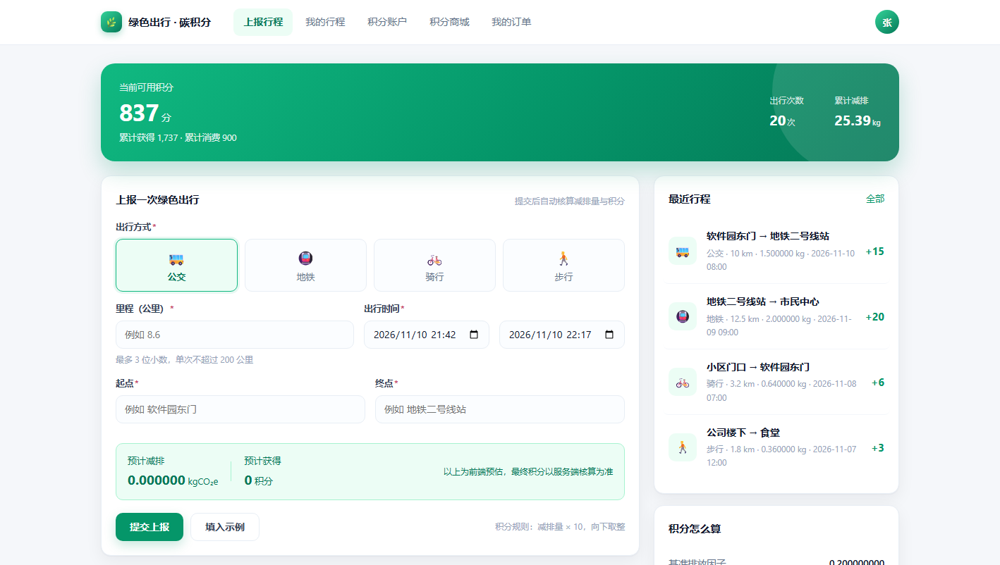
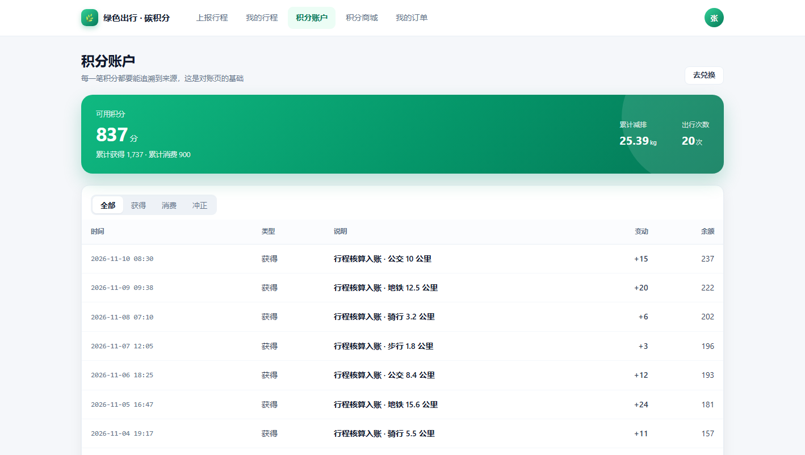
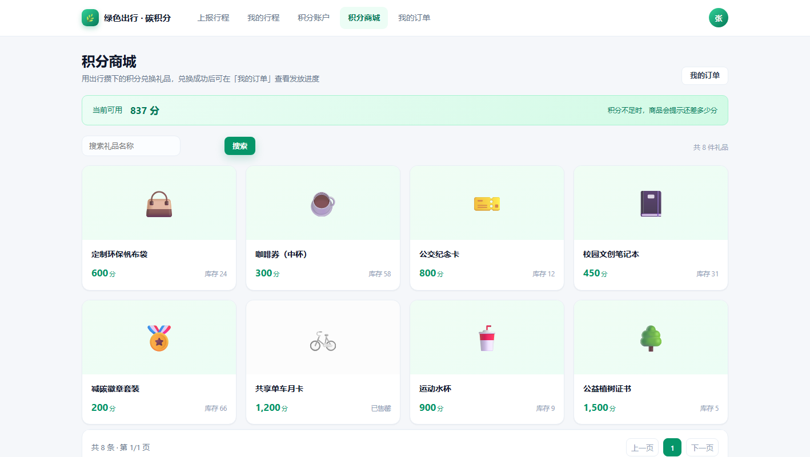
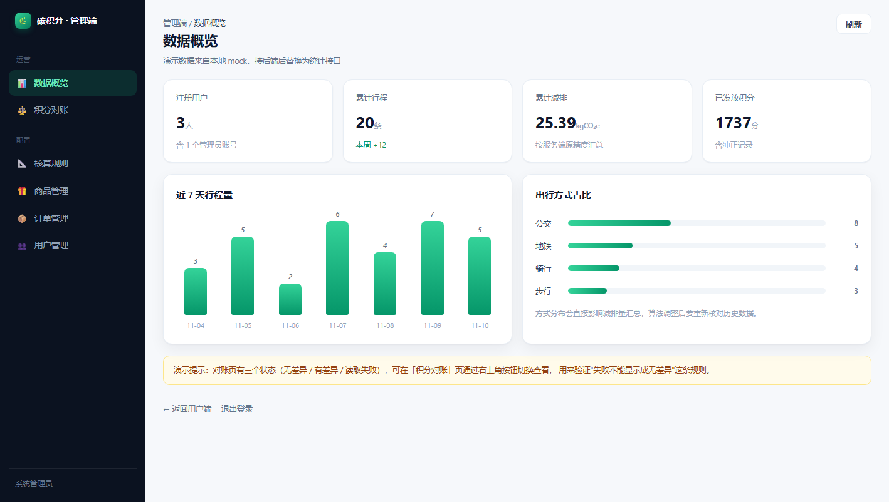
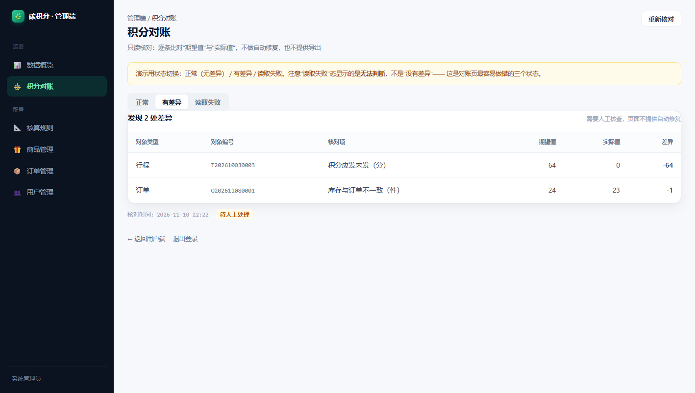

# 绿色出行 · 碳积分（前端演示版）

软件工程实验 · 前端交付物。**桌面独立窗口运行，不连接后端与数据库**，数据来自本地 mock，
但接口形状、字段命名、错误码、幂等键都按《接口契约》实现，接后端时只换数据源、不改页面。

- 技术栈：Vue 3.5 + Vite 6 + TypeScript(strict) + Vue Router 4(hash) + Pinia 3 + Axios（Electron 壳可选）
- 页面：用户端 9 页 + 认证 2 页 + 状态页 2 页 + 管理端 6 页
- 样式：自建设计 token 与组件类（`src/styles/`），未引入 Element Plus 等 UI 库



| 我的积分 | 积分商城 |
| --- | --- |
|  |  |

| 管理端 · 数据概览 | 管理端 · 积分对账 |
| --- | --- |
|  |  |

## 一、怎么启动

### 方式 1：桌面窗口（推荐，就是最终交付形态）

双击 **`启动桌面版.bat`**：它会把 `src` 打包成**单个 index.html**（`dist-app/`），
再用 Chrome/Edge 的「应用模式」开一个 1440×900 的独立窗口——没有地址栏、没有标签页，看起来就是一个桌面软件。

> 为什么要打成单文件：`file://` 下多文件构建的 `<script type="module">` 会被浏览器按跨域拦截（白屏），
> 单文件内联后就没有这个问题。Electron 同理，也是因为这个原因才用单文件产物。
> （本机 electron.exe 受运行环境限制启动即崩，属环境问题，不影响用窗口模式演示。）

### 方式 2：浏览器里看（调试最快）

双击 **`启动演示.bat`**，或执行：

```bat
npm run dev
```

然后访问 http://localhost:5173 。

> 如果 npm 报权限错误，先执行一次：
> `npm config set cache "%CD%\.npm-cache"`

## 二、演示账号

| 角色 | 账号 | 密码 | 进去能看到 |
| --- | --- | --- | --- |
| 普通用户 | `13800138000` | `123456` | 首页上报、行程、积分、商城、订单 |
| 管理员 | `admin` | `123456` | 管理端（概览/规则/商品/订单/对账/用户） |

## 三、演示脚本（答辩用，一条链路走完 5 分钟）

1. 用普通用户登录 → 首页看到积分余额与"近 30 天减排"。
2. 在首页表单填：地铁、10 km、起终点、起止时间 → 提交。
3. 自动跳到 **行程核算明细**：讲"因子快照 + 9 位原精度 + 积分取整"这三件事。
4. 进 **我的积分**：刚发的积分出现在流水顶部，余额变化。
5. 进 **积分商城** → 选一个商品 → 数量步进器 → 兑换 → **我的订单** 里出现新订单。
6. 在订单里取消（原因必填）→ 积分原额返还，流水出现"冲正"。
7. 换 `admin` 登录 → **积分对账** 页，切换三个状态：无差异 / 有差异 / 读取失败。
   > 重点讲："读取失败显示的是**无法判断**，不是没有差异"。

## 四、目录结构与职责

```
src/
├─ api/            接口层（页面只从这里拿数据）
│  ├─ http.ts      axios 实例 + 响应体校验 + 401 处理 + 幂等键
│  ├─ mock.ts      本地假后端（接后端后删掉/关掉即可）
│  └─ auth|trips|points|mall|orders|admin.ts   按模块分文件
├─ router/         路由 + 守卫（登录态、ADMIN 角色）
├─ stores/         Pinia：用户与登录态
├─ layouts/        UserLayout / AdminLayout
├─ components/     自建的 13 个基础组件
├─ views/          页面（user / admin / auth / state）
├─ styles/         tokens.css 设计变量、base.css 基础、components.css 组件类
├─ types/          全部数据结构（TS interface）
└─ utils/          格式化（6 位/9 位小数）与常量（状态文案、颜色）
```

## 五、接后端时要改的地方（只有这些）

1. `.env` 里把 `VITE_DATA_SOURCE=mock` 改成 `api`，并填 `VITE_API_BASE_URL`。
2. `src/api/http.ts`：确认响应体是 `{ code, message, data }`、`code === 0` 表示成功。
3. `vite.config.ts`：打开 `server.proxy` 的注释（开发时把 `/api` 转给 8080）。
4. 代码里所有 `// [接后端]` 注释处 = 需要跟后端确认的地方。
5. 后端字段若与 `src/types/index.ts` 不一致，**改类型文件，不改页面**。

## 六、这份 demo 有意做的"较真"之处（答辩加分点）

| 点 | 在哪看 | 为什么重要 |
| --- | --- | --- |
| 三态（加载/空/错） | 任意列表页 | 加载中显示"暂无数据"是典型错误 |
| 两种空态 | 行程/商城 | 首次无数据 vs 筛选无结果，给的按钮不一样 |
| 失败不冒充成功 | 对账页、提交超时 | 读取失败 ≠ 没有差异 |
| 幂等键 | 上报、兑换 | 重复点击/网络重试不会重复加分 |
| 精度 | 核算明细 | 页面 6 位、明细 9 位、积分取整用原值 |
| 快照 | 订单详情、行程明细 | 规则/价格改了，历史记录不能跟着变 |
| 权限 | 守卫 + 403 页 | 前端只做体验，真权限在后端 |

## 七、已知限制（写进实验报告"不足与改进"）

- 注册、商品的增删改、用户启停、履约发货属于 P1，演示版只读或不提供。
- 服务端渲染、暗色主题、国际化不做（实验范围内无必要）。
- mock 的延时是故意加的（280–500ms），用来观察加载态。

## 八、当前验证状态（2026-11-10）

- `npm run typecheck` 通过（TS strict，无 any 兜底）。
- `npm run build:single` 通过：`dist-app/index.html` 290KB（gzip 98KB）。
- 自动化冒烟：普通用户 7 个页面 + 管理员 6 个页面逐页打开，**0 条运行时报错**；
  普通用户访问 `/admin/*` 正确落到 403 页。
